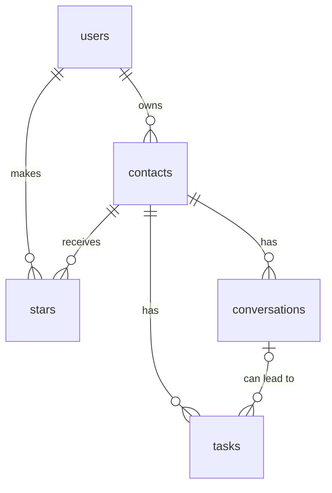

# Networking Tracker: Plan

## 1. Pitch

I'm building a personal CRM and project management tool for job-search networking because I think bottoms-up: I start with who I'm talking to and what I need to do for them to build rapport or get insight. I'd use it a few times a week.

## 2. Features

Numbered in the order I'll build them. Features 1–6 and 10 are the required spine, and 7–9 are my own.

1. **Sign up and login:** As a job seeker, I want to create an account, log in, and log out, so that my networking data is private to me.
2. **Data model:** As a job seeker, I want my contacts, conversations, and tasks stored and connected, so that everything stays attached to the right person.
3. **Manage contacts:** As a job seeker, I want to add, view, open, edit, and delete a contact, with an "are you sure?" warning before deleting, so that my rolodex stays accurate.
4. **Validation:** As a job seeker, I want a friendly message when I leave a required field blank, so that I don't save incomplete records.
5. **Stars:** As a job seeker, I want to star contacts and see a starred view, so that my priority people are easy to find.
6. **Find contacts:** As a job seeker, I want to search contacts by name, company, or related job, filter by company, and sort by newest or name A–Z, so that I can quickly find the person I'm thinking of.
7. **Log conversations:** As a job seeker, I want to log a conversation's date, type, and notes on a contact's page, so that I remember what we discussed.
8. **Tasks:** As a job seeker, I want to create tasks for a contact with a due date, priority, status, and notes, optionally linked to a conversation, so that I know what I owe each person.
9. **Needs attention and coming up:** As a job seeker, I want a home screen, grouped by person and company, that shows unfinished tasks due today or earlier and then tasks due in the next 7 days, and that I can filter by priority, so that I know who to follow up with and what's next.
10. **Dashboard:** As a job seeker, I want to see my open tasks, overdue tasks, and conversations this month, plus a chart of conversations per week, so that I can tell whether I'm keeping up my networking.

## 3. Database

Every primary key is `id`. Supabase Auth keeps passwords separately, and each sign-up automatically adds a row to `users`.

| Table | Column | Type | Required | Notes |
|---|---|---|---|---|
| `users` | id | text | Yes | Primary key, Supabase's user ID |
| | email | text | Yes | |
| | created_at | date | Yes | |
| `contacts` | id | number | Yes | Primary key |
| | user_id | text | Yes | Foreign key to `users` |
| | name | text | Yes | |
| | company | text | No | |
| | role | text | No | |
| | related_job | text | No | The job this contact came through |
| | how_we_met | text | No | |
| | email | text | No | |
| | linkedin | text | No | |
| | notes | text | No | |
| | created_at | date | Yes | |
| `conversations` | id | number | Yes | Primary key |
| | user_id | text | Yes | Foreign key to `users` |
| | contact_id | number | Yes | Foreign key to `contacts` |
| | date | date | Yes | |
| | type | text | Yes | Coffee chat, call, email, text, or event |
| | notes | text | No | |
| | created_at | date | Yes | |
| `tasks` | id | number | Yes | Primary key |
| | user_id | text | Yes | Foreign key to `users` |
| | contact_id | number | Yes | Foreign key to `contacts` |
| | conversation_id | number | No | Foreign key to `conversations` |
| | title | text | Yes | |
| | due_date | date | Yes | |
| | priority | text | Yes | High, medium, or low |
| | status | text | Yes | To do, waiting on them, or done |
| | notes | text | No | For example, a link someone sent me |
| | created_at | date | Yes | |
| `stars` | id | number | Yes | Primary key |
| | user_id | text | Yes | Foreign key to `users` |
| | contact_id | number | Yes | Foreign key to `contacts` |
| | created_at | date | Yes | |

**How the tables connect**

- One user has many contacts (one-to-many).
- One contact has many conversations and many tasks (one-to-many).
- One conversation can have many tasks (one-to-many), and a task doesn't need a conversation.
- Users and contacts connect through `stars` (many-to-many, junction table). A user can only star their own contacts.

**Rules**

- A task's linked conversation must be with the same contact. The task form only offers that contact's conversations.
- Deleting a contact also deletes their conversations, tasks, and star. The "are you sure?" message says what will be removed.
- Whether someone responded is set by hand, using the task's status.
- Row Level Security on every table means each user can only reach rows with their own `user_id`.

## 4. Tests

Both tests use made-up data only.

1. **Data isolation:** Given User A has a contact and User B has none, when User B logs in, opens their contact list, and tries to open User A's contact by its direct link, then the list is empty and the app refuses to show that contact.
2. **Dashboard stat (overdue tasks):** Given a user has one unfinished task due yesterday, one finished task due yesterday, and one unfinished task due tomorrow, when they open the dashboard, then "Overdue tasks" shows 1.

## 5. Technologies

- **Coding agent, Claude Code:** It can work directly with my files, Git, and GitHub.
- **App framework, Next.js:** One project holds both the screens and the behind-the-scenes logic, so there's less to connect.
- **Database, Supabase (Postgres):** I've used it before, it suits connected tables, and I can view my rows in its dashboard.
- **Sign up and login, Supabase Auth with email and password:** It handles passwords and login sessions securely, so I don't have to build that myself.
- **Hosting, Vercel:** It can redeploy each time I merge to main, which covers the deploy step of the feature loop.
- **Styling, Tailwind and shadcn/ui:** These provide ready-made forms, tables, and buttons, so less time goes to layout.
- **Chart, Recharts:** It's a common chart library for this kind of app, and I only need one chart.
- **Tests, Vitest:** It's a simple test runner, and my tests can use a separate database so they never touch my real data.

## 6. Design

**Feel:** Calm with a medium amount of color and detail. Backgrounds stay light and neutral, with color reserved for things that need my attention.

**Colors**

- Main accent: indigo, for buttons, links, and the current page.
- Second accent: coral, for anything overdue.
- Priority labels: high is coral, medium is amber, and low is gray.

**Inspiration**

- **Attio:** clean contact tables and a person page that shows their details, conversations, and tasks in one place.
- **Asana:** task rows with a checkbox, due date, and small colored labels.

**Home screen:** After login, I see Needs attention first, then Coming up for the next 7 days. Tasks are grouped under a heading with the person and company, such as "Sam Lee · Acme". Each row shows the title, due date, priority, and status, plus my notes, so a link someone sent me is right there. The dashboard is one click away.

## 7. Risks and cuts

**Least sure I can build:** An intuitive dashboard of what I have going on that is user-friendly and gives a good experience.

**What I'll cut first, in order:** The spine features and my 3 features all stay, so I'll cut extras inside them.

1. Linking a task to a specific conversation.
2. The company filter, since search and sort still cover feature 6.
3. The Coming up section.
4. Grouping by person on the home screen, falling back to a simple list that shows the person and company on each row.

**Out of scope for now:** Gmail access, a browser extension, natural-language input with AI, and email reminders. I'm very unsure I can build the AI and browser extension pieces. Company and application tables are also a future iteration. For now, company is plain text, so "Google" and "google" count as different companies.
