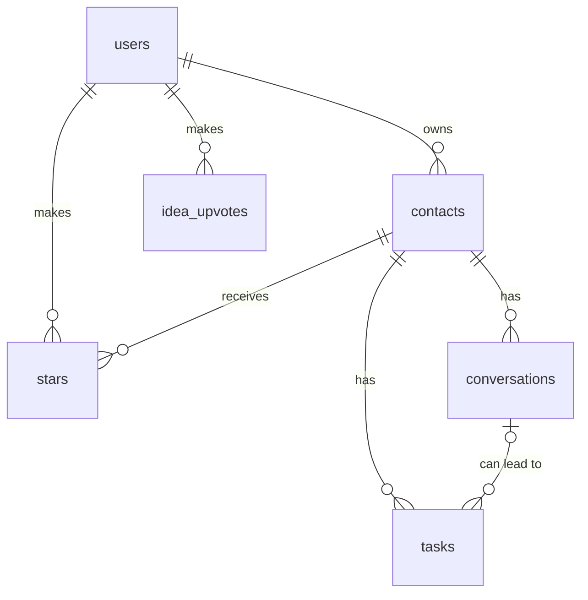

# Database schema

The app uses Supabase (Postgres). Every table has Row Level Security on, so each user can only reach their own rows. The SQL is in `supabase/migrations/`.

## Tables

### `users`

One row per account. A trigger adds it at sign-up. Passwords stay in Supabase Auth's own protected area and are not in this table.

| Column | Type | Required | Notes |
|---|---|---|---|
| id | uuid | Yes | Primary key, Supabase's user ID |
| email | text | Yes | |
| created_at | timestamp | Yes | |

### `contacts`

The main item: one row per person in your rolodex.

| Column | Type | Required | Notes |
|---|---|---|---|
| id | number | Yes | Primary key |
| user_id | uuid | Yes | Foreign key to `users` |
| name | text | Yes | Can't be blank |
| company | text | No | |
| role | text | No | |
| related_job | text | No | The job this contact came through |
| how_we_met | text | No | |
| email | text | No | |
| linkedin | text | No | |
| notes | text | No | |
| created_at | timestamp | Yes | |

### `conversations`

| Column | Type | Required | Notes |
|---|---|---|---|
| id | number | Yes | Primary key |
| user_id | uuid | Yes | Must match the contact's owner |
| contact_id | number | Yes | Foreign key to `contacts` |
| date | date | Yes | |
| type | text | Yes | Coffee chat, call, email, text, or event |
| notes | text | No | |
| created_at | timestamp | Yes | |

### `tasks`

| Column | Type | Required | Notes |
|---|---|---|---|
| id | number | Yes | Primary key |
| user_id | uuid | Yes | Must match the contact's owner |
| contact_id | number | Yes | Foreign key to `contacts` |
| conversation_id | number | No | Foreign key to `conversations`, must be with the same contact |
| title | text | Yes | Can't be blank |
| due_date | date | Yes | |
| priority | text | Yes | High, medium, or low |
| status | text | Yes | To do, waiting on them, or done |
| notes | text | No | For example, a link someone sent |
| created_at | timestamp | Yes | |

### `stars`

The junction table connecting users and contacts. There's one table for everyone, and each row means "this user starred this contact."

| Column | Type | Required | Notes |
|---|---|---|---|
| id | number | Yes | Primary key |
| user_id | uuid | Yes | Must match the contact's owner |
| contact_id | number | Yes | Foreign key to `contacts` |
| created_at | timestamp | Yes | |

A user can star a given contact only once.

### `idea_upvotes`

One row per upvote on a future idea in the Automate Everything popup. The ideas themselves live in the app's code, not in a table.

| Column | Type | Required | Notes |
|---|---|---|---|
| id | number | Yes | Primary key |
| user_id | uuid | Yes | Foreign key to `users` |
| idea_id | text | Yes | One of the six ideas in `src/lib/future-ideas.ts` |
| created_at | timestamp | Yes | |

A user can upvote a given idea only once, and can't remove an upvote.

## How the tables relate

- One user has many contacts.
- One contact has many conversations and many tasks.
- One conversation can have many tasks, and a task doesn't need a conversation.
- Users and contacts connect through `stars`.

## What happens on delete

- Deleting a contact also deletes their conversations, tasks, and star.
- Deleting a conversation keeps its tasks and clears their link.

## Compared with section 3 of the plan

The agent built the tables and columns I designed, with these differences:

| Plan | Built | Why |
|---|---|---|
| User IDs are text | User IDs use `uuid` | That's the type Supabase uses for its user IDs |
| `created_at` is a date | `created_at` is a date and time | It sorts contacts by newest more reliably |
| A task's conversation must match its contact, enforced by the form | The database enforces it too | A bug in the form can't create a mismatch |
| Not in the plan | Rows can only point to the same user's rows | Row Level Security alone wouldn't check the row being pointed to |
| Not in the plan | One star per user per contact | Stops a double-click creating two stars |
| Not in the plan | Deleting a conversation keeps its tasks | The plan only covered deleting a contact |
| Not in the plan | `idea_upvotes` table | I added upvotes on future ideas after submitting, to see which ones people want |
